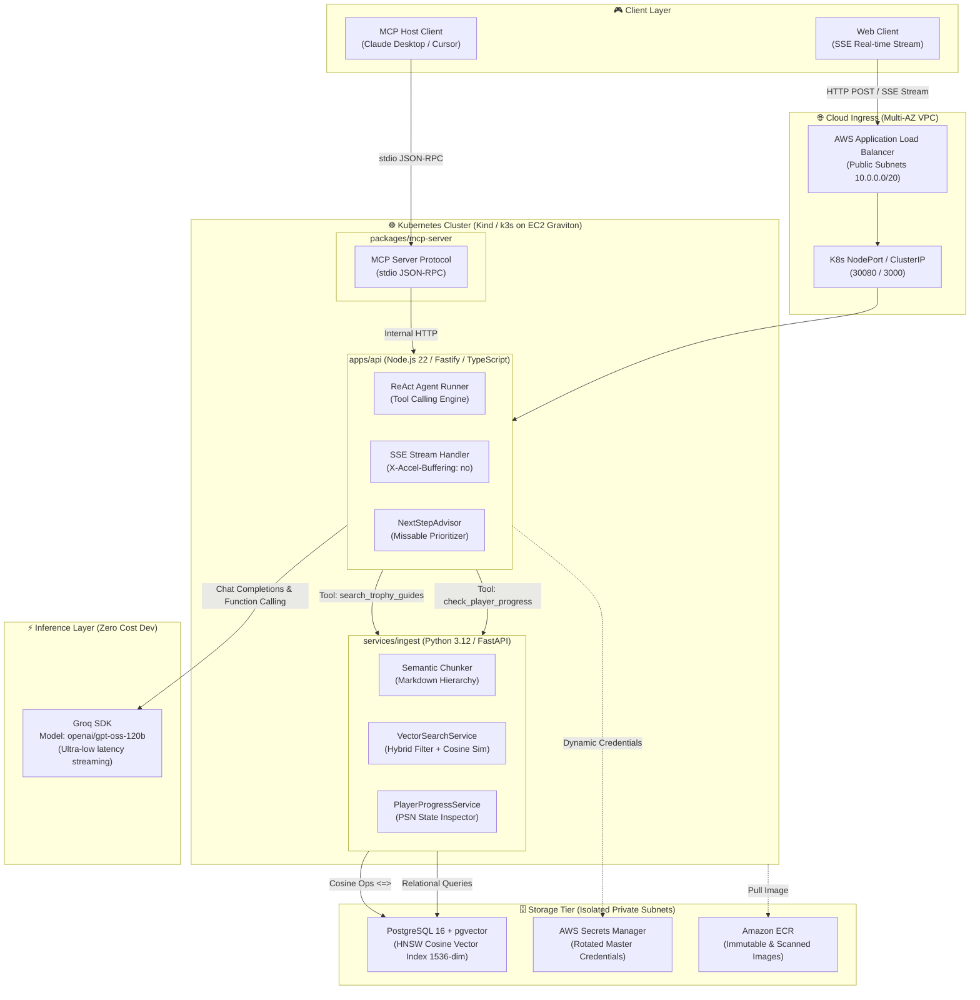

<div align="center">

# 🏆 Platina AI
**Autonomous AI Assistant & RAG Engine for PlayStation Trophy Hunters**

[](https://github.com/WeineOlliver/platina-ai/actions/workflows/ci.yml)
[](LICENSE)
[](docs/architecture.md)
[-purple)](packages/mcp-server)

*An autonomous AI agent engineered for PlayStation trophy hunters to prevent missable trophies, optimize platinum roadmaps, and track trophy progress against verified walkthrough vector embeddings.*

[Overview](#-overview) • [Architecture](#-system-architecture) • [Key Features](#-key-features) • [Tech Stack](#-technology-stack) • [Roadmap](ROADMAP.md) • [FinOps & Costs](#-finops--cloud-cost-strategy) • [Quickstart](#-quickstart--local-setup)

</div>

---

## 🎮 Overview

**Platina AI** is an autonomous assistant built specifically for **PlayStation trophy hunters and completionists**. 

In massive games like *The Witcher 3: Wild Hunt*, *Bloodborne*, *Elden Ring*, and *Grand Theft Auto V*, players face **irreversible missable trophies**: advancing past a story milestone or failing a sidequest lock out the Platinum trophy permanently, forcing a 40+ to 100+ hour replay.

Generic chatbots fail because they hallucinate quest prerequisites and cannot inspect game state. **Platina AI** provides:
1. **Targeted for Trophy Hunters:** Structured tracking of missable warnings, point-of-no-return alerts, and tactical cleanup roadmaps.
2. **Canonical Catalog & Entity Linking:** Exact relational catalog of games and trophies linked to verified guide chunks, preventing hallucinations.
3. **Owner PSN Telemetry:** Optional live trophy synchronization for the project owner's profile via NPSSO (`psn-api`), comparing unlocked trophies against pending missables.
4. **Universal Interoperability via MCP:** Exposes guides and tools to developer environments (Claude Desktop, Cursor) via the open **Model Context Protocol (MCP)** standard.

---

## 🏛️ System Architecture

Platina AI is built as a polyglot microservice ecosystem running in Docker Compose, local Kubernetes (**Kind**), and AWS cloud infrastructure (**k3s on EC2 Graviton**) provisioned declaratively via **Terraform** and **Helm** (with enterprise Amazon EKS migration outlined in [ROADMAP.md](ROADMAP.md)).



*For complete sequence traces and security group chaining diagrams, see [docs/architecture.md](docs/architecture.md).*

---

## ✨ Key Features

| Capability | Implementation Details | Architecture Highlights |
| :--- | :--- | :--- |
| **Autonomous ReAct Agent** | `PlatinaAgentRunner` in Fastify alternating between reasoning, tool calling, and observation over SSE frames (`tool_call`, `tool_result`, `chunk`, `done`). | Guards against infinite loops (`maxSteps: 5`) and supports mid-stream `AbortSignal` cancellation. |
| **Proactive Advising** | `POST /api/v1/agent/next-step` compares player telemetry against missable warnings and returns a structured gameplay checklist. | Enforced JSON schema output via Zod with session time estimations and source citations. |
| **Semantic Ingestion & RAG** | Python FastAPI service splitting guides by Markdown headers with sliding character overlap (200 chars). | 1536-dimensional L2-normalized embeddings stored in PostgreSQL 16 `pgvector` with HNSW cosine indexing (`vector_cosine_ops`). |
| **Model Context Protocol (MCP)** | Dedicated `@platina-ai/mcp-server` package exposing guides as **Resources** (`platina://guides/{game}`) and workflows as **Tools**. | Connects directly to Claude Desktop, Claude Code CLI, and Cursor via standard `stdio` JSON-RPC. |
| **Production Cloud & IaC** | 3-tier multi-AZ VPC, PostgreSQL RDS with pgvector, ECR registries, k3s on Graviton, and declarative Helm releases in OpenTofu/Terraform. | Strict security group chaining (`ALB` -> `App` -> `Database`) with zero hardcoded credentials in git. |

---

## 🛠️ Technology Stack

- **API & Orchestration:** Node.js 22, TypeScript, Fastify 5, `@fastify/jwt`, `@fastify/rate-limit`, Zod.
- **AI & RAG Microservice:** Python 3.12, Astral `uv`, FastAPI, SQLAlchemy 2.0 (asyncpg), pgvector-python, Pydantic v2.
- **LLM Inference:** Groq SDK (`openai/gpt-oss-120b`), Structured JSON Mode, Function Calling.
- **Database & Storage:** PostgreSQL 16 with `pgvector` extension and HNSW indexing.
- **Protocol Interoperability:** `@modelcontextprotocol/sdk` (Model Context Protocol).
- **Containerization & K8s:** Multi-stage Docker (`node:22-alpine`, `python:3.12-slim`), Docker Compose, Helm v2, Kind, k3s.
- **Cloud Infrastructure as Code:** OpenTofu / Terraform (AWS S3 remote backend, DynamoDB locks, VPC, RDS, ECR, AWS Budgets).
- **CI/CD & Testing:** GitHub Actions, Vitest (110+ unit & benchmark tests), Pytest (110 unit, entity linking, and RAG evaluation tests).

---

## 💰 FinOps & Cloud Cost Strategy

A core design requirement was demonstrating production-grade enterprise cloud architecture while maintaining **aggressive cost control**:

1. **Zero-Cost Development Inference:** Leveraging Groq's high-speed open-model tier (`openai/gpt-oss-120b`) eliminates API token costs during development and automated CI runs.
2. **EC2 Graviton k3s vs. Amazon EKS:** Deploying certified k3s to an AWS Graviton2 EC2 instance (`t4g.small`, ~$12/month) slashes the mandatory $73/month flat fee of an EKS control plane while preserving 100% Kubernetes API compatibility.
3. **Tag-Scoped AWS Budget Cap:** Configured via Terraform (`infra/terraform/budget.tf`) with a strict ceiling of **$1.00 USD**, triggering email alerts at 80% ($0.80) actual spend and 100% forecasted overrun.
4. **Single-Command Instant Teardown:** Automated script (`infra/terraform/destroy.sh`) cleanly uninstalls Helm releases, drops RDS instances (`skip_final_snapshot = true`), and resets ongoing cloud idle costs to **$0.00**.

---

## 🚀 Quickstart & Local Setup

### Prerequisites
- [Docker Desktop](https://www.docker.com/) or Docker Engine
- [Node.js 22+](https://nodejs.org/) & [uv](https://astral.sh/uv) (for native development)
- [Homebrew](https://brew.sh/) (optional: `kind`, `kubectl`, `helm`, `opentofu`)

### Option A: Run Full Stack via Docker Compose (Recommended)
Clone the repository and bring up PostgreSQL (pgvector), Python Ingestion, and Node.js API with a single command:

```bash
git clone https://github.com/WeineOlliver/platina-ai.git
cd platina-ai

# Start all three tiers with healthcheck gates
docker compose up --build
```
- **Fastify API:** `http://localhost:3000`
- **Interactive UI:** `http://localhost:3000/ui`
- **Python Ingestion Service:** `http://localhost:8000/docs`
- **PostgreSQL pgvector:** `localhost:5432` (Database: `platina_rag`)

### Option B: Test the ReAct Agent in the Terminal
Run an autonomous multi-step reasoning query testing player progress and vector guide retrieval:

```bash
curl -sN -X POST http://localhost:3000/api/v1/agent/run \
  -H "Content-Type: application/json" \
  -d '{
    "message": "Qual o meu próximo passo urgente na platina de Bloodborne?",
    "game": "Bloodborne"
  }'
```

### Option C: Get Proactive Next-Step Advice (JSON Output)
```bash
curl -s -X POST http://localhost:3000/api/v1/agent/next-step \
  -H "Content-Type: application/json" \
  -d '{"game": "Bloodborne"}' | jq .
```

---

## 📚 Architectural Decision Records (ADRs)

Key architectural trade-offs are documented following standard ADR conventions in `docs/adr/`:

- [ADR 0001: Record Architecture Decisions](docs/adr/0001-record-architecture-decisions.md)
- [ADR 0002: Chunking Strategy and Vector Embedding Architecture](docs/adr/0002-chunking-strategy-and-embeddings.md)
- [ADR 0003: Agentic Architecture, Tool Calling Contracts, and MCP Server](docs/adr/0003-agent-architecture-and-mcp.md)
- [ADR 0004: Kubernetes Infrastructure: Amazon EKS vs. Lightweight k3s / Kind](docs/adr/0004-eks-vs-k3s.md)
- [ADR 0005: Terraform Cloud Architecture Organization and FinOps Controls](docs/adr/0005-terraform-organization.md)

---

## 🗺️ Engineering Roadmap

Planned architectural improvements, infrastructure expansions, and upcoming milestones (40h+ of scoped work) are tracked in **[ROADMAP.md](ROADMAP.md)**:
- Canonical ingestion engine v2 with Pydantic contracts and multi-game expansion
- Terraform module decomposition (`modules/vpc`, `modules/rds`, `modules/compute`, `modules/ecr`)
- Production Helm chart hardening (HPA, PDBs, automated ACM TLS termination)
- CI/CD automation pipeline (matrix testing, vulnerability scanning, and automated Kubernetes releases)
- Agent response caching and SSE backpressure handling

---

## 📄 License
This project is licensed under the MIT License - see the [LICENSE](LICENSE) file for details.
