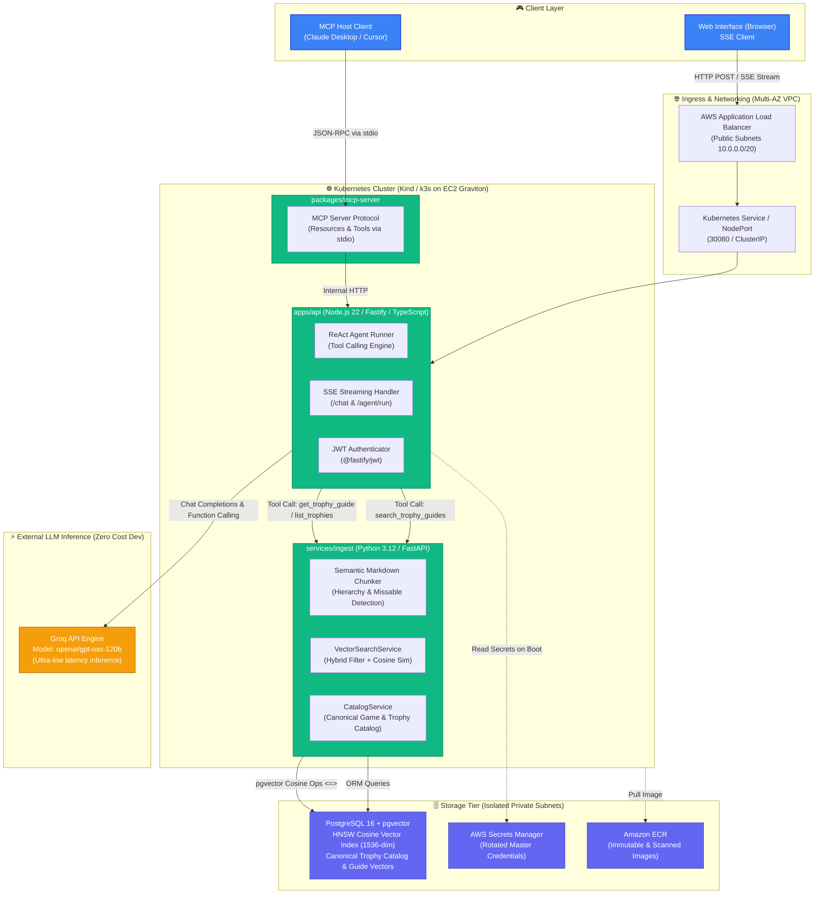
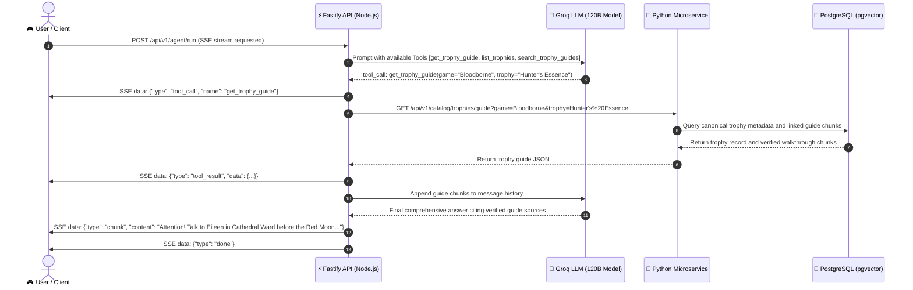
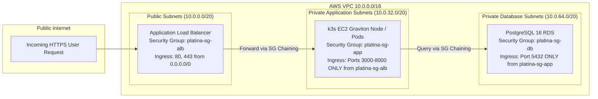

# Platina AI System Architecture

This document describes the high-level system architecture, networking topology, and data flow of **Platina AI**—an autonomous AI assistant for PlayStation trophy hunting and platinum roadmap optimization.

---

## 1. High-Level Architecture Diagram

---

## 2. Multi-Step Agent Execution Flow (ReAct Loop)

> **Privacy & Data Architecture Note**: Platina AI operates strictly without accessing, syncing, or storing third-party PlayStation Network accounts or personal player data. The project answers questions exclusively from verified community trophy guides (PowerPyx, PSNProfiles) and the canonical relational game trophy catalog.

When a player asks: *"How do I get the Hunter's Essence trophy in Bloodborne?"*:

---

## 3. Defense-in-Depth Networking & Security Architecture

---

## 4. Key Architectural Highlights for Technical Interviews

1. **Polyglot Monorepo Separation:**
   - **Fastify (Node.js/TypeScript):** Chosen for lightweight non-blocking event-loop performance, ultra-fast SSE streaming, and type-safe Zod runtime schema isolation.
   - **FastAPI (Python):** Chosen for native ecosystem compatibility with data ingestion, HTML parsing, and semantic vector operations.
2. **Decoupled Tool Calling (ReAct Loop):**
   - The LLM dynamically selects tools on demand (`get_trophy_guide`, `list_trophies`, `search_trophy_guides`) rather than naively stuffing vector context into every prompt.
3. **Open Model Context Protocol (MCP):**
   - A standalone package (`@platina-ai/mcp-server`) exposes trophy guides as **Resources** and agent workflows as **Tools** over standard `stdio`, allowing zero-code interoperability with Claude Desktop and Cursor.
4. **Declarative Cloud Infrastructure & FinOps:**
   - Unified Terraform and Helm setup supporting local zero-cost development on Kind and cloud staging on Amazon Web Services.
   - Enforces a hard budget ceiling of **$1.00 USD** with proactive alerts, backed by single-command automated teardown (`destroy.sh`).
